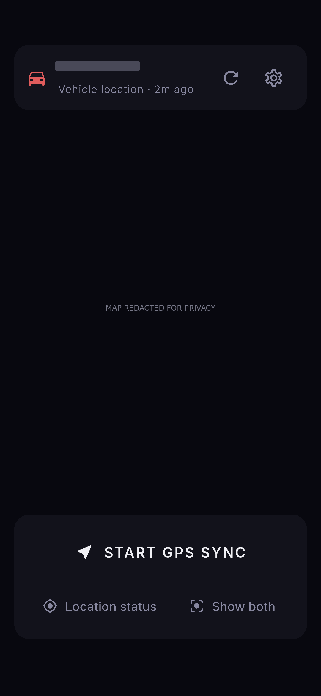
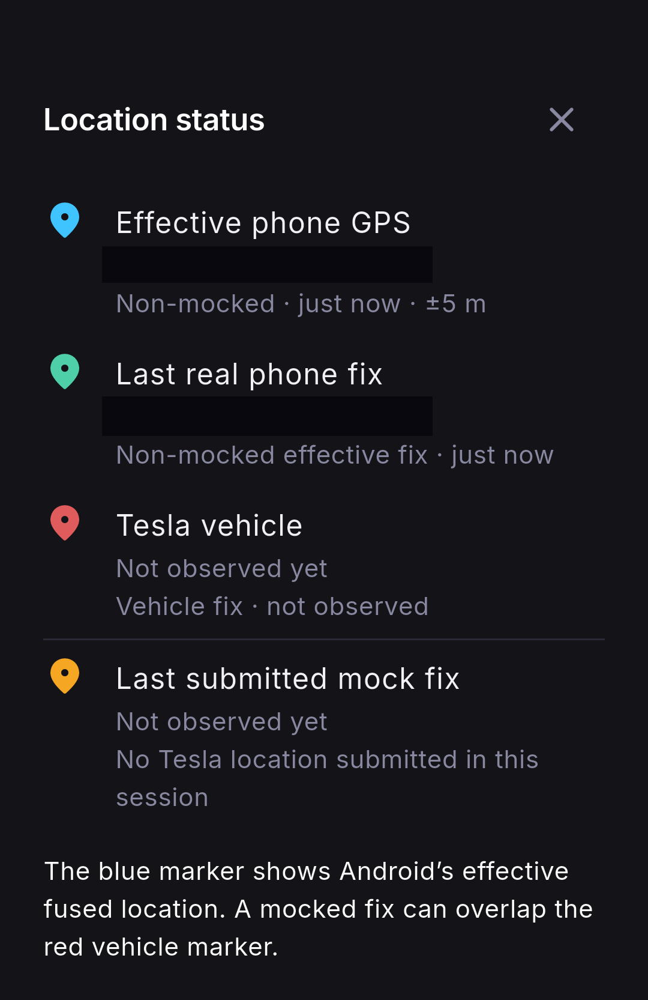
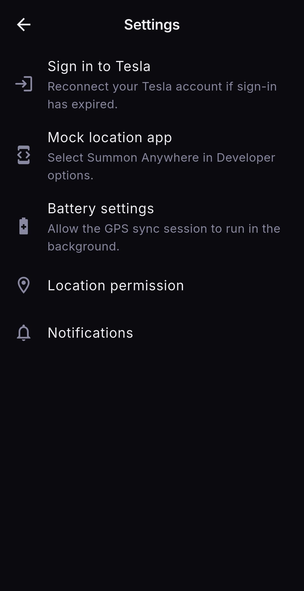

# Summon Anywhere

Based on [usamasaleem1/summon-anywhere-tesla](https://github.com/usamasaleem1/summon-anywhere-tesla).

*Display a Tesla's location and mirror it to Android mock GPS.*


Summon Anywhere is an Android Flutter app that reads vehicle location through
the Tesla Fleet API and shows it alongside the phone's effective location on a
Google Maps satellite map. It does not send vehicle-control or wake commands.

**Start GPS Sync** starts a foreground session lasting up to five minutes. The
app polls available vehicle coordinates approximately every five seconds and
submits fresh coordinates to Android GPS and Google fused location. **Stop**
requests the session to stop and starts GPS cleanup. The location-status sheet separates
the Tesla fix, submitted mock, effective phone location and last real phone fix.
Other apps can detect or decline mocked locations.

Sleeping or offline vehicles may not return coordinates. The app retries and
backs off on API failures and rate limits, and rejects stale or invalid fixes.
Fleet API calls may incur charges; see [Tesla's billing and limits](https://developer.tesla.com/docs/fleet-api/billing-and-limits).

## Setup

See [SETUP](docs/SETUP.md) for Tesla registration, Maps configuration, Android
permissions, installation and troubleshooting. [REQUIREMENTS](docs/REQUIREMENTS.md)
lists the Android and development toolchain requirements.

```sh
git clone https://github.com/DreamMakers2/Tesla-Summon-Anywhere.git
cd Tesla-Summon-Anywhere
flutter pub get
```

Configure the ignored `secrets.json` and `android/local.properties` files as
described in SETUP, then run:

```sh
dart run build_runner build
flutter run --dart-define-from-file=secrets.json
```

**Never publicly distribute APKs containing real credentials.** The build embeds
Tesla client credentials and the Google Maps key in the APK, where they can be
extracted. See [SECURITY](SECURITY.md) for credential handling and local data.

## Screenshots

These are real device captures. Map imagery, vehicle identifiers, coordinates
and the device status bar are obscured for privacy. The main-screen image also
conceals map details behind the translucent panels.

  

## Development

`lib/core` contains authentication, API, location and storage services;
`lib/features` contains the screens and background session; `android/app`
contains native Android integration. See [CONTRIBUTING](CONTRIBUTING.md) for
source checks and contribution guidelines.

## License

The project retains the upstream MIT license and copyright notice; see
[LICENSE](LICENSE) and [NOTICE](NOTICE). Bundled Inter fonts use the
[SIL Open Font License](assets/fonts/OFL.txt). Dependencies retain their
individual licenses. This project is not an official Tesla or Google product.
